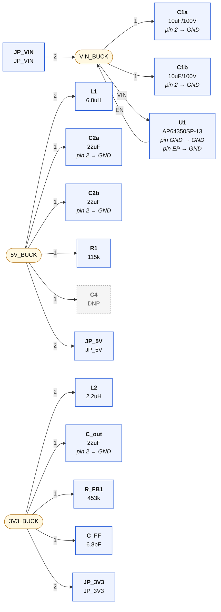
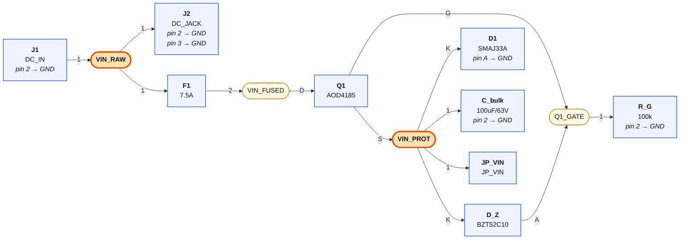
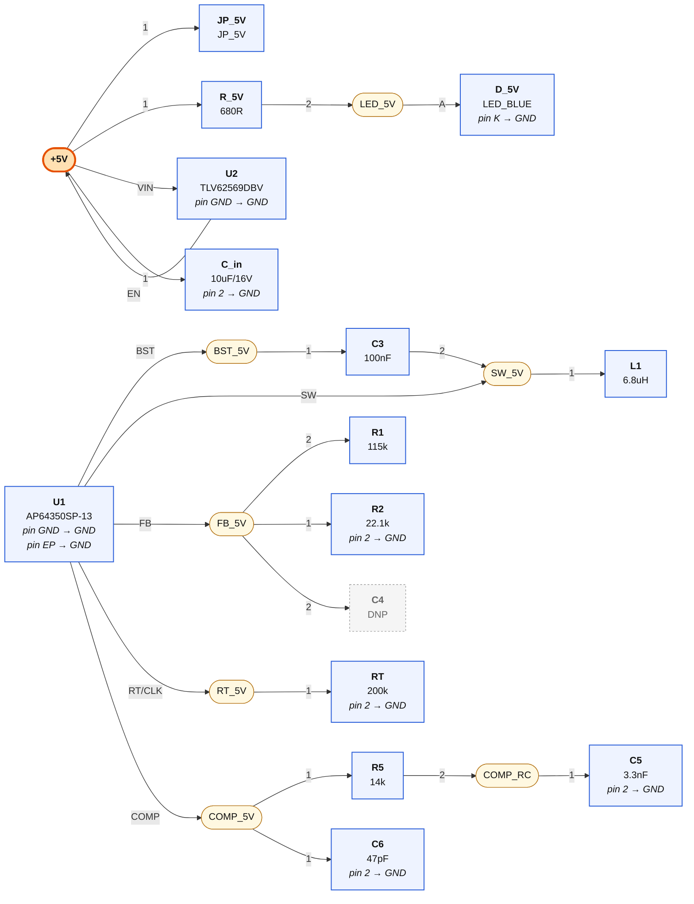
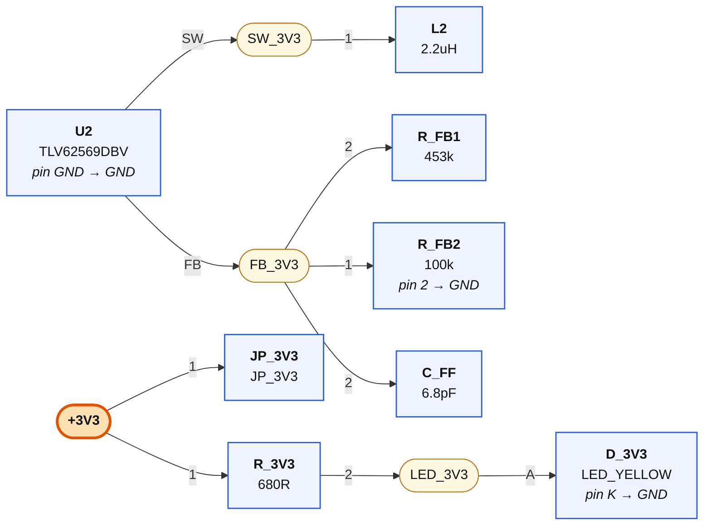

# 01-power — wiring diagrams

Generated from `01-power.net.yaml` by `tools/checknet.py --mermaid`. Read each diagram left to right along the signal path. **Boxes are parts, rounded nodes are nets, the label on a line is the pin.** A part's power-rail pins are written inside its box. A multi-unit chip (a quad gate) appears once per unit — one box per triangle, exactly as KiCad places it. Open the `.html` next to this file in any browser to see it rendered.

## Staged-power links (bring-up)

| Net | connect every one of these |
|---|---|
| **VIN_BUCK** | `JP_VIN.2`, `C1a.1`, `C1b.1`, `U1.VIN`, `U1.EN` |
| **5V_BUCK** | `L1.2`, `C2a.1`, `C2b.1`, `R1.1`, `C4.1`, `JP_5V.2` |
| **3V3_BUCK** | `L2.2`, `C_out.1`, `R_FB1.1`, `C_FF.1`, `JP_3V3.2` |

## Protection stage: J1 → VIN_PROT

| Net | connect every one of these |
|---|---|
| **VIN_RAW** | `J1.1`, `J2.1`, `F1.1` |
| **VIN_FUSED** | `F1.2`, `Q1.D` |
| **VIN_PROT** | `Q1.S`, `D_Z.K`, `D1.K`, `C_bulk.1`, `JP_VIN.1` |
| **Q1_GATE** | `Q1.G`, `D_Z.A`, `R_G.1` |

## Rail 1: AP64350, VIN_PROT → +5V

| Net | connect every one of these |
|---|---|
| **BST_5V** | `U1.BST`, `C3.1` |
| **SW_5V** | `U1.SW`, `C3.2`, `L1.1` |
| **+5V** | `JP_5V.1`, `R_5V.1`, `U2.VIN`, `U2.EN`, `C_in.1` |
| **FB_5V** | `R1.2`, `R2.1`, `C4.2`, `U1.FB` |
| **RT_5V** | `U1.RT/CLK`, `RT.1` |
| **COMP_5V** | `U1.COMP`, `R5.1`, `C6.1` |
| **COMP_RC** | `R5.2`, `C5.1` |
| **LED_5V** | `R_5V.2`, `D_5V.A` |

## Rail 2: TLV62569, +5V → +3V3

| Net | connect every one of these |
|---|---|
| **SW_3V3** | `U2.SW`, `L2.1` |
| **+3V3** | `JP_3V3.1`, `R_3V3.1` |
| **FB_3V3** | `U2.FB`, `R_FB1.2`, `R_FB2.1`, `C_FF.2` |
| **LED_3V3** | `R_3V3.2`, `D_3V3.A` |

## GND

Every pin below goes to the GND symbol:

`J1.2`, `J2.2`, `J2.3`, `R_G.2`, `D1.A`, `C1a.2`, `C1b.2`, `C_bulk.2`, `U1.GND`, `U1.EP`, `RT.2`, `R2.2`, `C5.2`, `C6.2`, `C2a.2`, `C2b.2`, `D_5V.K`, `U2.GND`, `C_in.2`, `C_out.2`, `R_FB2.2`, `D_3V3.K`
