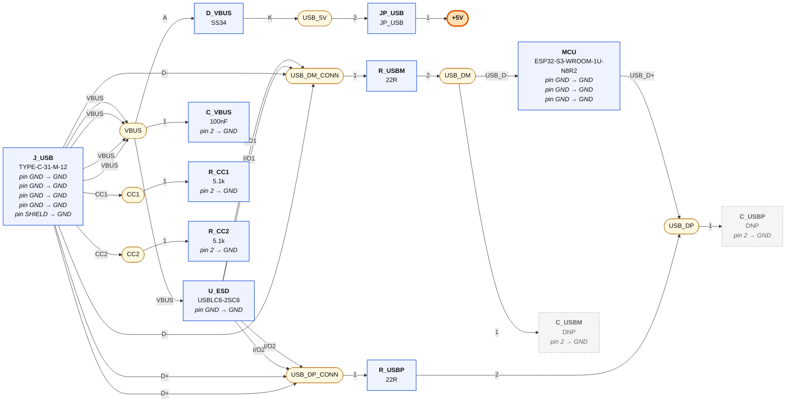
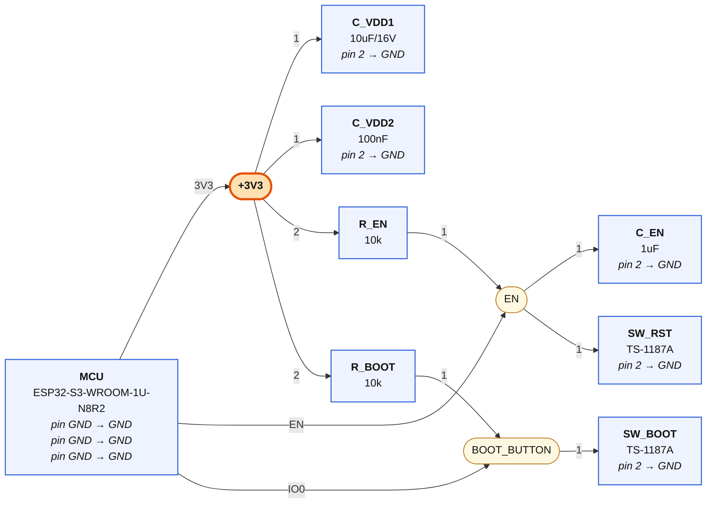

# 02-mcu-usb — wiring diagrams

Generated from `02-mcu-usb.net.yaml` by `tools/checknet.py --mermaid`. Read each diagram left to right along the signal path. **Boxes are parts, rounded nodes are nets, the label on a line is the pin.** A part's power-rail pins are written inside its box. A multi-unit chip (a quad gate) appears once per unit — one box per triangle, exactly as KiCad places it. Open the `.html` next to this file in any browser to see it rendered.

## USB: connector → ESD → module

| Net | connect every one of these |
|---|---|
| **VBUS** | `J_USB.VBUS`, `J_USB.VBUS`, `J_USB.VBUS`, `J_USB.VBUS`, `U_ESD.VBUS`, `D_VBUS.A`, `C_VBUS.1` |
| **USB_5V** | `D_VBUS.K`, `JP_USB.2` |
| **+5V** | `JP_USB.1` |
| **USB_DM_CONN** | `J_USB.D-`, `J_USB.D-`, `U_ESD.I/O1`, `U_ESD.I/O1`, `R_USBM.1` |
| **USB_DP_CONN** | `J_USB.D+`, `J_USB.D+`, `U_ESD.I/O2`, `U_ESD.I/O2`, `R_USBP.1` |
| **USB_DM** | `R_USBM.2`, `MCU.USB_D-`, `C_USBM.1` |
| **USB_DP** | `R_USBP.2`, `MCU.USB_D+`, `C_USBP.1` |
| **CC1** | `J_USB.CC1`, `R_CC1.1` |
| **CC2** | `J_USB.CC2`, `R_CC2.1` |

## Module core: power, reset, boot

| Net | connect every one of these |
|---|---|
| **+3V3** | `MCU.3V3`, `C_VDD1.1`, `C_VDD2.1`, `R_EN.2`, `R_BOOT.2` |
| **EN** | `MCU.EN`, `R_EN.1`, `C_EN.1`, `SW_RST.1` |
| **BOOT_BUTTON** | `MCU.IO0`, `R_BOOT.1`, `SW_BOOT.1` |

## GPIO fan-out — every label EXACTLY as pinmap.yaml

```mermaid
graph LR
  classDef part fill:#eef3ff,stroke:#2b5fd9,stroke-width:1.5px,color:#111
  classDef net fill:#fff8e1,stroke:#b7791f,color:#111
  classDef rail fill:#ffe0b2,stroke:#e65100,stroke-width:3px,color:#111,font-weight:bold
  classDef badnet fill:#ffe0e0,stroke:#c00,stroke-width:3px,color:#111,font-weight:bold
  classDef absent fill:#fff,stroke:#c00,stroke-width:2px,stroke-dasharray:6 4,color:#c00
  classDef extra fill:#ffecec,stroke:#c00,stroke-width:2px,color:#111
  classDef dnp fill:#f5f5f5,stroke:#999,stroke-dasharray:3 3,color:#666
  N_ANALOG_IN_1(["ANALOG_IN_1"]):::net
  P_MCU["<b>MCU</b><br/>ESP32-S3-WROOM-1U-N8R2<br/><i>pin GND → GND</i><br/><i>pin GND → GND</i><br/><i>pin GND → GND</i>"]:::part
  P_MCU --"IO1"--> N_ANALOG_IN_1
  N_ANALOG_IN_2(["ANALOG_IN_2"]):::net
  P_MCU --"IO2"--> N_ANALOG_IN_2
  N_LED_STRIP_1_CLK(["LED_STRIP_1_CLK"]):::net
  P_MCU --"IO3"--> N_LED_STRIP_1_CLK
  N_LED_STRIP_1_DATA(["LED_STRIP_1_DATA"]):::net
  P_MCU --"IO4"--> N_LED_STRIP_1_DATA
  N_LED_STRIP_2_DATA(["LED_STRIP_2_DATA"]):::net
  P_MCU --"IO5"--> N_LED_STRIP_2_DATA
  N_LED_STRIP_2_CLK(["LED_STRIP_2_CLK"]):::net
  P_MCU --"IO6"--> N_LED_STRIP_2_CLK
  N_I2S_BCLK(["I2S_BCLK"]):::net
  P_MCU --"IO7"--> N_I2S_BCLK
  N_I2C_SDA(["I2C_SDA"]):::net
  P_MCU --"IO8"--> N_I2C_SDA
  N_I2C_SCL(["I2C_SCL"]):::net
  P_MCU --"IO9"--> N_I2C_SCL
  N_DIGITAL_IN_1(["DIGITAL_IN_1"]):::net
  P_MCU --"IO10"--> N_DIGITAL_IN_1
  N_DIGITAL_IN_2(["DIGITAL_IN_2"]):::net
  P_MCU --"IO11"--> N_DIGITAL_IN_2
  N_DIGITAL_IN_3(["DIGITAL_IN_3"]):::net
  P_MCU --"IO12"--> N_DIGITAL_IN_3
  N_STEPPER_1_STEP(["STEPPER_1_STEP"]):::net
  P_MCU --"IO13"--> N_STEPPER_1_STEP
  N_STEPPER_1_DIR(["STEPPER_1_DIR"]):::net
  P_MCU --"IO14"--> N_STEPPER_1_DIR
  N_I2S_LRCLK(["I2S_LRCLK"]):::net
  P_MCU --"IO15"--> N_I2S_LRCLK
  N_I2S_DOUT(["I2S_DOUT"]):::net
  P_MCU --"IO16"--> N_I2S_DOUT
  N_TMC_UART_TX(["TMC_UART_TX"]):::net
  P_MCU --"IO17"--> N_TMC_UART_TX
  N_TMC_UART_RX(["TMC_UART_RX"]):::net
  P_MCU --"IO18"--> N_TMC_UART_RX
  N_STEPPER_2_STEP(["STEPPER_2_STEP"]):::net
  P_MCU --"IO21"--> N_STEPPER_2_STEP
  N_MOTOR_B_IN1(["MOTOR_B_IN1"]):::net
  P_MCU --"IO35"--> N_MOTOR_B_IN1
  N_MOTOR_B_IN2(["MOTOR_B_IN2"]):::net
  P_MCU --"IO36"--> N_MOTOR_B_IN2
  N_STATUS_LED(["STATUS_LED"]):::net
  P_MCU --"IO38"--> N_STATUS_LED
  N_SD_CLK(["SD_CLK"]):::net
  P_MCU --"IO39"--> N_SD_CLK
  N_SD_CMD(["SD_CMD"]):::net
  P_MCU --"IO40"--> N_SD_CMD
  N_SD_D0(["SD_D0"]):::net
  P_MCU --"IO41"--> N_SD_D0
  N_STEPPER_1_DIAG(["STEPPER_1_DIAG"]):::net
  P_MCU --"IO42"--> N_STEPPER_1_DIAG
  N_STEPPER_2_DIAG(["STEPPER_2_DIAG"]):::net
  P_MCU --"TXD0"--> N_STEPPER_2_DIAG
  N_MOTOR_A_IN1(["MOTOR_A_IN1"]):::net
  P_MCU --"RXD0"--> N_MOTOR_A_IN1
  N_MOTOR_A_IN2(["MOTOR_A_IN2"]):::net
  P_MCU --"IO48"--> N_MOTOR_A_IN2
  N_EXPANSION_1(["EXPANSION_1"]):::net
  P_MCU --"IO45"--> N_EXPANSION_1
  N_EXPANSION_2(["EXPANSION_2"]):::net
  P_MCU --"IO46"--> N_EXPANSION_2
  N_STEPPER_2_DIR(["STEPPER_2_DIR"]):::net
  P_MCU --"IO47"--> N_STEPPER_2_DIR
  N_PCA_OE(["PCA_OE"]):::net
  P_MCU --"IO37"--> N_PCA_OE
  P_TP_OE["<b>TP_OE</b><br/>PCA_OE"]:::part
  N_PCA_OE --"1"--> P_TP_OE
```

| Net | connect every one of these |
|---|---|
| **ANALOG_IN_1** | `MCU.IO1` |
| **ANALOG_IN_2** | `MCU.IO2` |
| **LED_STRIP_1_CLK** | `MCU.IO3` |
| **LED_STRIP_1_DATA** | `MCU.IO4` |
| **LED_STRIP_2_DATA** | `MCU.IO5` |
| **LED_STRIP_2_CLK** | `MCU.IO6` |
| **I2S_BCLK** | `MCU.IO7` |
| **I2C_SDA** | `MCU.IO8` |
| **I2C_SCL** | `MCU.IO9` |
| **DIGITAL_IN_1** | `MCU.IO10` |
| **DIGITAL_IN_2** | `MCU.IO11` |
| **DIGITAL_IN_3** | `MCU.IO12` |
| **STEPPER_1_STEP** | `MCU.IO13` |
| **STEPPER_1_DIR** | `MCU.IO14` |
| **I2S_LRCLK** | `MCU.IO15` |
| **I2S_DOUT** | `MCU.IO16` |
| **TMC_UART_TX** | `MCU.IO17` |
| **TMC_UART_RX** | `MCU.IO18` |
| **STEPPER_2_STEP** | `MCU.IO21` |
| **MOTOR_B_IN1** | `MCU.IO35` |
| **MOTOR_B_IN2** | `MCU.IO36` |
| **STATUS_LED** | `MCU.IO38` |
| **SD_CLK** | `MCU.IO39` |
| **SD_CMD** | `MCU.IO40` |
| **SD_D0** | `MCU.IO41` |
| **STEPPER_1_DIAG** | `MCU.IO42` |
| **STEPPER_2_DIAG** | `MCU.TXD0` |
| **MOTOR_A_IN1** | `MCU.RXD0` |
| **MOTOR_A_IN2** | `MCU.IO48` |
| **EXPANSION_1** | `MCU.IO45` |
| **EXPANSION_2** | `MCU.IO46` |
| **STEPPER_2_DIR** | `MCU.IO47` |
| **PCA_OE** | `MCU.IO37`, `TP_OE.1` |

## GND

Every pin below goes to the GND symbol:

`MCU.GND`, `MCU.GND`, `MCU.GND`, `J_USB.GND`, `J_USB.GND`, `J_USB.GND`, `J_USB.GND`, `J_USB.SHIELD`, `U_ESD.GND`, `R_CC1.2`, `R_CC2.2`, `C_EN.2`, `C_VDD1.2`, `C_VDD2.2`, `SW_RST.2`, `SW_BOOT.2`, `C_VBUS.2`, `C_USBM.2`, `C_USBP.2`
