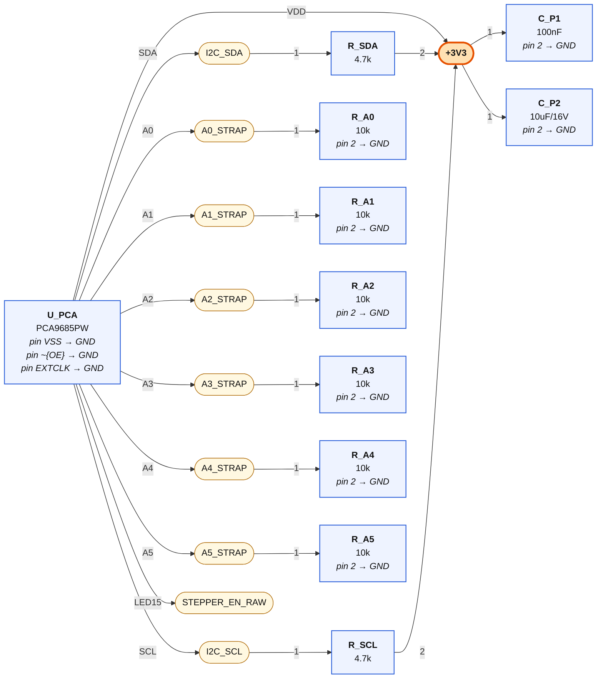
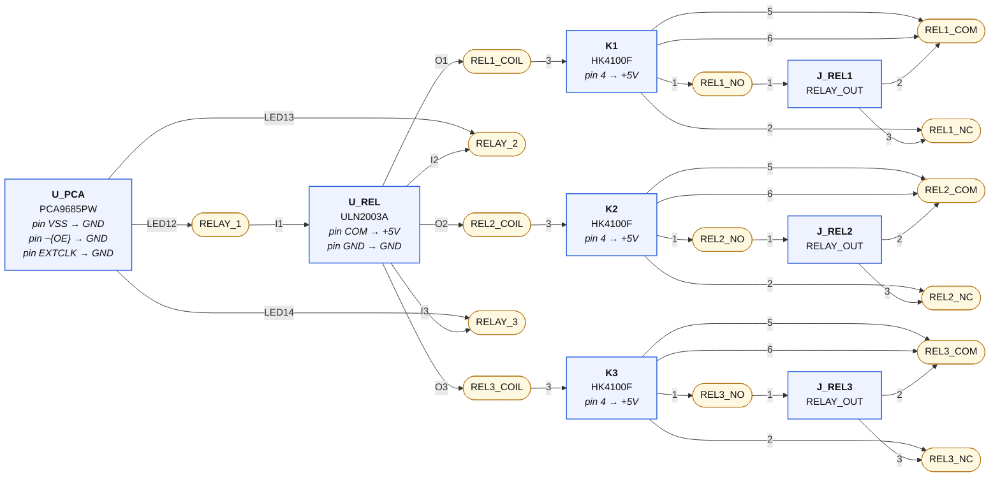
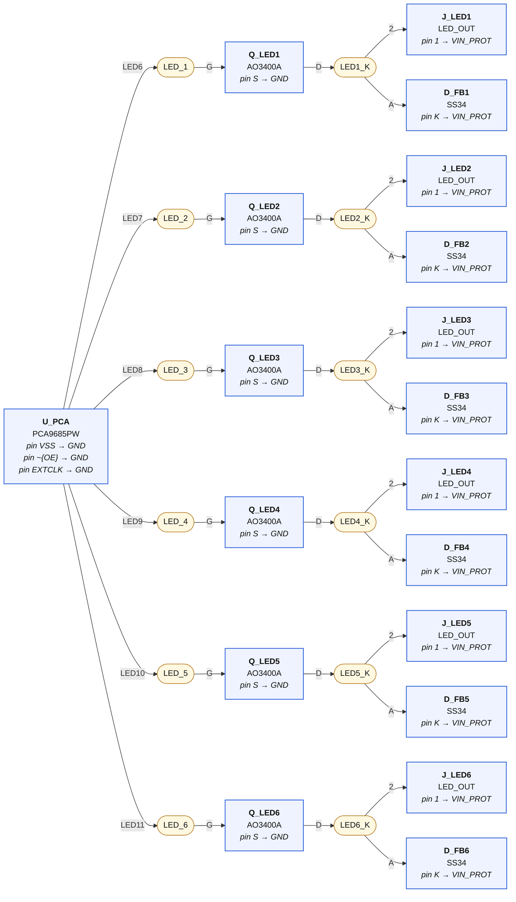
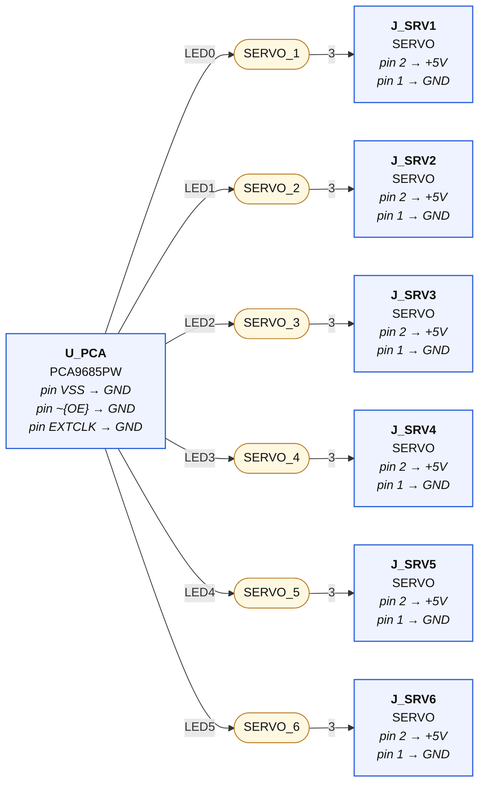

# 03-outputs — wiring diagrams

Generated from `03-outputs.net.yaml` by `tools/checknet.py --mermaid`. Read each diagram left to right along the signal path. **Boxes are parts, rounded nodes are nets, the label on a line is the pin.** A part's power-rail pins are written inside its box. Open the `.html` next to this file in any browser to see it rendered.

## I²C + PCA9685 core

| Net | connect every one of these |
|---|---|
| **I2C_SDA** | `U_PCA.SDA`, `R_SDA.1` |
| **I2C_SCL** | `U_PCA.SCL`, `R_SCL.1` |
| **+3V3** | `U_PCA.VDD`, `R_SDA.2`, `R_SCL.2`, `C_P1.1`, `C_P2.1` |
| **A0_STRAP** | `U_PCA.A0`, `R_A0.1` |
| **A1_STRAP** | `U_PCA.A1`, `R_A1.1` |
| **A2_STRAP** | `U_PCA.A2`, `R_A2.1` |
| **A3_STRAP** | `U_PCA.A3`, `R_A3.1` |
| **A4_STRAP** | `U_PCA.A4`, `R_A4.1` |
| **A5_STRAP** | `U_PCA.A5`, `R_A5.1` |
| **STEPPER_EN_RAW** | `U_PCA.LED15` |

## Relay channels ×3

| Net | connect every one of these |
|---|---|
| **RELAY_1** | `U_PCA.LED12`, `U_REL.I1` |
| **REL1_COIL** | `U_REL.O1`, `K1.3` |
| **REL1_NO** | `K1.1`, `J_REL1.1` |
| **REL1_COM** | `K1.5`, `K1.6`, `J_REL1.2` |
| **REL1_NC** | `K1.2`, `J_REL1.3` |
| **RELAY_2** | `U_PCA.LED13`, `U_REL.I2` |
| **REL2_COIL** | `U_REL.O2`, `K2.3` |
| **REL2_NO** | `K2.1`, `J_REL2.1` |
| **REL2_COM** | `K2.5`, `K2.6`, `J_REL2.2` |
| **REL2_NC** | `K2.2`, `J_REL2.3` |
| **RELAY_3** | `U_PCA.LED14`, `U_REL.I3` |
| **REL3_COIL** | `U_REL.O3`, `K3.3` |
| **REL3_NO** | `K3.1`, `J_REL3.1` |
| **REL3_COM** | `K3.5`, `K3.6`, `J_REL3.2` |
| **REL3_NC** | `K3.2`, `J_REL3.3` |

## DC switch/dim channels ×6 (AO3400A low-side, supply-voltage loads)

| Net | connect every one of these |
|---|---|
| **LED_1** | `U_PCA.LED6`, `Q_LED1.G` |
| **LED1_K** | `Q_LED1.D`, `J_LED1.2`, `D_FB1.A` |
| **LED_2** | `U_PCA.LED7`, `Q_LED2.G` |
| **LED2_K** | `Q_LED2.D`, `J_LED2.2`, `D_FB2.A` |
| **LED_3** | `U_PCA.LED8`, `Q_LED3.G` |
| **LED3_K** | `Q_LED3.D`, `J_LED3.2`, `D_FB3.A` |
| **LED_4** | `U_PCA.LED9`, `Q_LED4.G` |
| **LED4_K** | `Q_LED4.D`, `J_LED4.2`, `D_FB4.A` |
| **LED_5** | `U_PCA.LED10`, `Q_LED5.G` |
| **LED5_K** | `Q_LED5.D`, `J_LED5.2`, `D_FB5.A` |
| **LED_6** | `U_PCA.LED11`, `Q_LED6.G` |
| **LED6_K** | `Q_LED6.D`, `J_LED6.2`, `D_FB6.A` |

## Servo headers ×6

| Net | connect every one of these |
|---|---|
| **SERVO_1** | `U_PCA.LED0`, `J_SRV1.3` |
| **SERVO_2** | `U_PCA.LED1`, `J_SRV2.3` |
| **SERVO_3** | `U_PCA.LED2`, `J_SRV3.3` |
| **SERVO_4** | `U_PCA.LED3`, `J_SRV4.3` |
| **SERVO_5** | `U_PCA.LED4`, `J_SRV5.3` |
| **SERVO_6** | `U_PCA.LED5`, `J_SRV6.3` |

## GND

Every pin below goes to the GND symbol:

`U_PCA.VSS`, `U_PCA.~{OE}`, `U_PCA.EXTCLK`, `U_REL.GND`, `R_A0.2`, `R_A1.2`, `R_A2.2`, `R_A3.2`, `R_A4.2`, `R_A5.2`, `C_P1.2`, `C_P2.2`, `Q_LED1.S`, `Q_LED2.S`, `Q_LED3.S`, `Q_LED4.S`, `Q_LED5.S`, `Q_LED6.S`, `J_SRV1.1`, `J_SRV2.1`, `J_SRV3.1`, `J_SRV4.1`, `J_SRV5.1`, `J_SRV6.1`

## +5V

Every pin below goes to the +5V symbol:

`K1.4`, `K2.4`, `K3.4`, `U_REL.COM`, `J_SRV1.2`, `J_SRV2.2`, `J_SRV3.2`, `J_SRV4.2`, `J_SRV5.2`, `J_SRV6.2`

## VIN_PROT

Every pin below goes to the VIN_PROT symbol:

`J_LED1.1`, `J_LED2.1`, `J_LED3.1`, `J_LED4.1`, `J_LED5.1`, `J_LED6.1`, `D_FB1.K`, `D_FB2.K`, `D_FB3.K`, `D_FB4.K`, `D_FB5.K`, `D_FB6.K`
