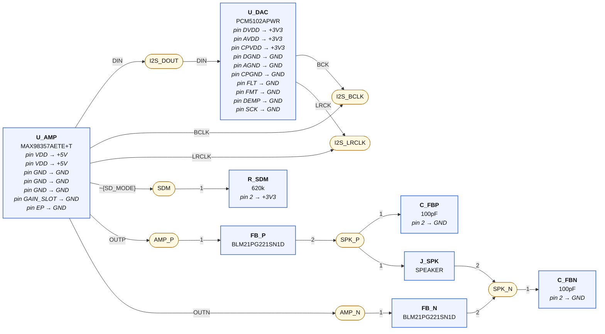
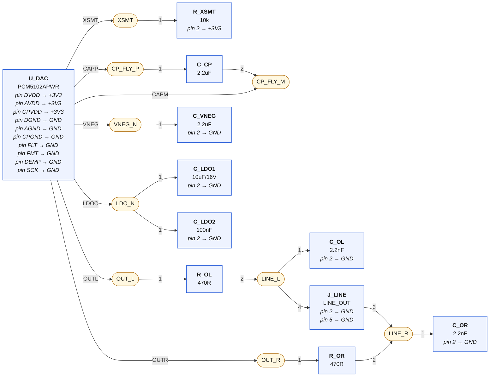
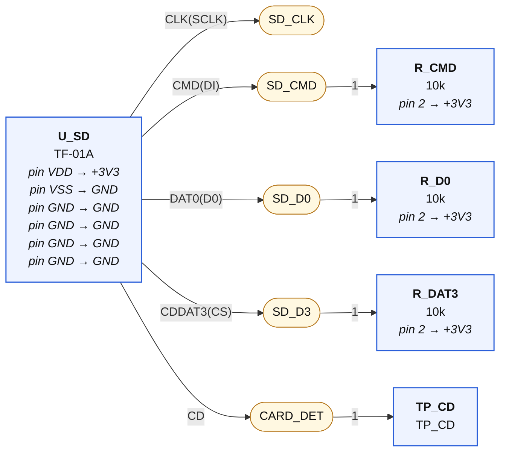

# 04-audio — wiring diagrams

Generated from `04-audio.net.yaml` by `tools/checknet.py --mermaid`. Read each diagram left to right along the signal path. **Boxes are parts, rounded nodes are nets, the label on a line is the pin.** A part's power-rail pins are written inside its box. A multi-unit chip (a quad gate) appears once per unit — one box per triangle, exactly as KiCad places it. Open the `.html` next to this file in any browser to see it rendered.

## I²S amp → speaker (mono mix, 12 dB)

| Net | connect every one of these |
|---|---|
| **I2S_DOUT** | `U_AMP.DIN`, `U_DAC.DIN` |
| **I2S_BCLK** | `U_AMP.BCLK`, `U_DAC.BCK` |
| **I2S_LRCLK** | `U_AMP.LRCLK`, `U_DAC.LRCK` |
| **SDM** | `U_AMP.~{SD_MODE}`, `R_SDM.1` |
| **AMP_P** | `U_AMP.OUTP`, `FB_P.1` |
| **SPK_P** | `FB_P.2`, `C_FBP.1`, `J_SPK.1` |
| **AMP_N** | `U_AMP.OUTN`, `FB_N.1` |
| **SPK_N** | `FB_N.2`, `C_FBN.1`, `J_SPK.2` |

## Line-out DAC (PCM5102A) → 3.5 mm jack

| Net | connect every one of these |
|---|---|
| **XSMT** | `U_DAC.XSMT`, `R_XSMT.1` |
| **CP_FLY_P** | `U_DAC.CAPP`, `C_CP.1` |
| **CP_FLY_M** | `U_DAC.CAPM`, `C_CP.2` |
| **VNEG_N** | `U_DAC.VNEG`, `C_VNEG.1` |
| **LDO_N** | `U_DAC.LDOO`, `C_LDO1.1`, `C_LDO2.1` |
| **OUT_L** | `U_DAC.OUTL`, `R_OL.1` |
| **LINE_L** | `R_OL.2`, `C_OL.1`, `J_LINE.4` |
| **OUT_R** | `U_DAC.OUTR`, `R_OR.1` |
| **LINE_R** | `R_OR.2`, `C_OR.1`, `J_LINE.3` |

## microSD — SDMMC 1-bit

| Net | connect every one of these |
|---|---|
| **SD_CLK** | `U_SD.CLK(SCLK)` |
| **SD_CMD** | `U_SD.CMD(DI)`, `R_CMD.1` |
| **SD_D0** | `U_SD.DAT0(D0)`, `R_D0.1` |
| **SD_D3** | `U_SD.CDDAT3(CS)`, `R_DAT3.1` |
| **CARD_DET** | `U_SD.CD`, `TP_CD.1` |

## Rail-only parts ×10 — decoupling; wire each pin to its rail symbol, place beside its chip

```mermaid
graph LR
  classDef part fill:#eef3ff,stroke:#2b5fd9,stroke-width:1.5px,color:#111
  classDef net fill:#fff8e1,stroke:#b7791f,color:#111
  classDef rail fill:#ffe0b2,stroke:#e65100,stroke-width:3px,color:#111,font-weight:bold
  classDef badnet fill:#ffe0e0,stroke:#c00,stroke-width:3px,color:#111,font-weight:bold
  classDef absent fill:#fff,stroke:#c00,stroke-width:2px,stroke-dasharray:6 4,color:#c00
  classDef extra fill:#ffecec,stroke:#c00,stroke-width:2px,color:#111
  classDef dnp fill:#f5f5f5,stroke:#999,stroke-dasharray:3 3,color:#666
  P_C_A1["<b>C_A1</b><br/>10uF/16V<br/><i>pin 1 → +5V</i><br/><i>pin 2 → GND</i>"]:::part
  P_C_A2["<b>C_A2</b><br/>100nF<br/><i>pin 1 → +5V</i><br/><i>pin 2 → GND</i>"]:::part
  P_C_SD1["<b>C_SD1</b><br/>10uF/16V<br/><i>pin 1 → +3V3</i><br/><i>pin 2 → GND</i>"]:::part
  P_C_SD2["<b>C_SD2</b><br/>100nF<br/><i>pin 1 → +3V3</i><br/><i>pin 2 → GND</i>"]:::part
  P_C_DV1["<b>C_DV1</b><br/>10uF/16V<br/><i>pin 1 → +3V3</i><br/><i>pin 2 → GND</i>"]:::part
  P_C_DV2["<b>C_DV2</b><br/>100nF<br/><i>pin 1 → +3V3</i><br/><i>pin 2 → GND</i>"]:::part
  P_C_AV1["<b>C_AV1</b><br/>10uF/16V<br/><i>pin 1 → +3V3</i><br/><i>pin 2 → GND</i>"]:::part
  P_C_AV2["<b>C_AV2</b><br/>100nF<br/><i>pin 1 → +3V3</i><br/><i>pin 2 → GND</i>"]:::part
  P_C_CPV1["<b>C_CPV1</b><br/>10uF/16V<br/><i>pin 1 → +3V3</i><br/><i>pin 2 → GND</i>"]:::part
  P_C_CPV2["<b>C_CPV2</b><br/>100nF<br/><i>pin 1 → +3V3</i><br/><i>pin 2 → GND</i>"]:::part
```

| Net | connect every one of these |
|---|---|

## GND

Every pin below goes to the GND symbol:

`U_AMP.GND`, `U_AMP.GND`, `U_AMP.GND`, `U_AMP.GAIN_SLOT`, `U_AMP.EP`, `C_FBP.2`, `C_FBN.2`, `C_A1.2`, `C_A2.2`, `U_SD.VSS`, `U_SD.GND`, `U_SD.GND`, `U_SD.GND`, `U_SD.GND`, `C_SD1.2`, `C_SD2.2`, `U_DAC.DGND`, `U_DAC.AGND`, `U_DAC.CPGND`, `U_DAC.FLT`, `U_DAC.FMT`, `U_DAC.DEMP`, `U_DAC.SCK`, `C_VNEG.2`, `C_OL.2`, `C_OR.2`, `C_DV1.2`, `C_DV2.2`, `C_LDO1.2`, `C_LDO2.2`, `C_AV1.2`, `C_AV2.2`, `C_CPV1.2`, `C_CPV2.2`, `J_LINE.2`, `J_LINE.5`

## +5V

Every pin below goes to the +5V symbol:

`U_AMP.VDD`, `U_AMP.VDD`, `C_A1.1`, `C_A2.1`

## +3V3

Every pin below goes to the +3V3 symbol:

`U_SD.VDD`, `C_SD1.1`, `C_SD2.1`, `R_CMD.2`, `R_D0.2`, `R_DAT3.2`, `R_SDM.2`, `U_DAC.DVDD`, `U_DAC.AVDD`, `U_DAC.CPVDD`, `R_XSMT.2`, `C_DV1.1`, `C_DV2.1`, `C_AV1.1`, `C_AV2.1`, `C_CPV1.1`, `C_CPV2.1`
