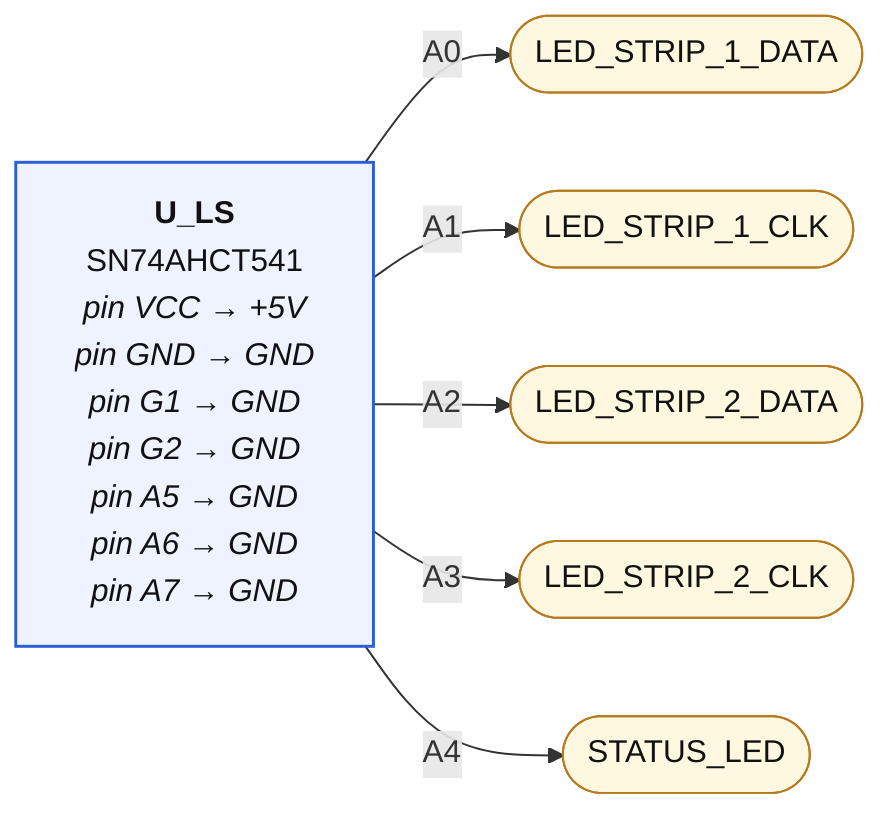
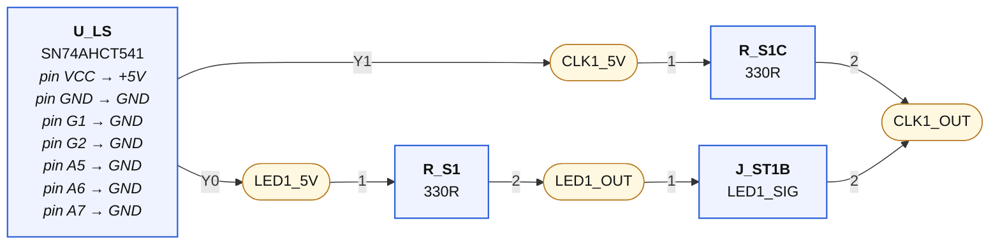
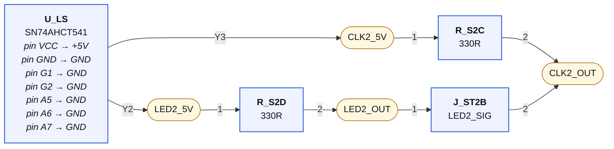
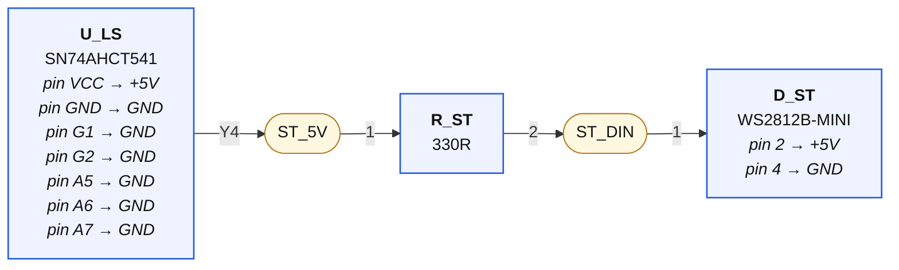
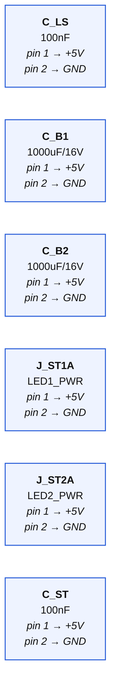

# 05-led — wiring diagrams

Generated from `05-led.net.yaml` by `tools/checknet.py --mermaid`. Read each diagram left to right along the signal path. **Boxes are parts, rounded nodes are nets, the label on a line is the pin.** A part's power-rail pins are written inside its box. A multi-unit chip (a quad gate) appears once per unit — one box per triangle, exactly as KiCad places it. Open the `.html` next to this file in any browser to see it rendered.

## Level shifter — inputs (A side)

| Net | connect every one of these |
|---|---|
| **LED_STRIP_1_DATA** | `U_LS.A0` |
| **LED_STRIP_1_CLK** | `U_LS.A1` |
| **LED_STRIP_2_DATA** | `U_LS.A2` |
| **LED_STRIP_2_CLK** | `U_LS.A3` |
| **STATUS_LED** | `U_LS.A4` |

## Strip 1 (3/4-wire)

| Net | connect every one of these |
|---|---|
| **LED1_5V** | `U_LS.Y0`, `R_S1.1` |
| **LED1_OUT** | `R_S1.2`, `J_ST1B.1` |
| **CLK1_5V** | `U_LS.Y1`, `R_S1C.1` |
| **CLK1_OUT** | `R_S1C.2`, `J_ST1B.2` |

## Strip 2 (3/4-wire)

| Net | connect every one of these |
|---|---|
| **LED2_5V** | `U_LS.Y2`, `R_S2D.1` |
| **LED2_OUT** | `R_S2D.2`, `J_ST2B.1` |
| **CLK2_5V** | `U_LS.Y3`, `R_S2C.1` |
| **CLK2_OUT** | `R_S2C.2`, `J_ST2B.2` |

## Status pixel

| Net | connect every one of these |
|---|---|
| **ST_5V** | `U_LS.Y4`, `R_ST.1` |
| **ST_DIN** | `R_ST.2`, `D_ST.1` |

## Rail-only parts ×6 — decoupling; wire each pin to its rail symbol, place beside its chip

| Net | connect every one of these |
|---|---|

## GND

Every pin below goes to the GND symbol:

`U_LS.GND`, `U_LS.G1`, `U_LS.G2`, `U_LS.A5`, `U_LS.A6`, `U_LS.A7`, `C_LS.2`, `J_ST1A.2`, `J_ST2A.2`, `C_B1.2`, `C_B2.2`, `D_ST.4`, `C_ST.2`

## +5V

Every pin below goes to the +5V symbol:

`U_LS.VCC`, `C_LS.1`, `J_ST1A.1`, `J_ST2A.1`, `C_B1.1`, `C_B2.1`, `D_ST.2`, `C_ST.1`
