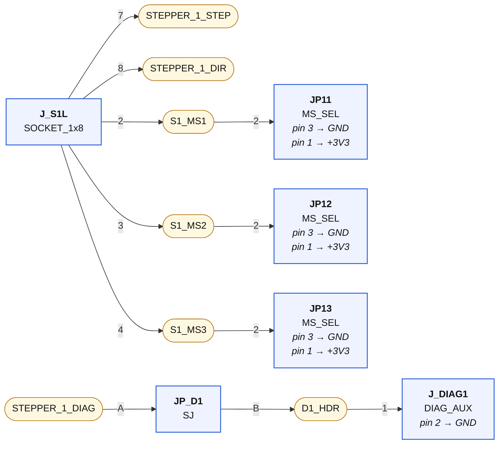
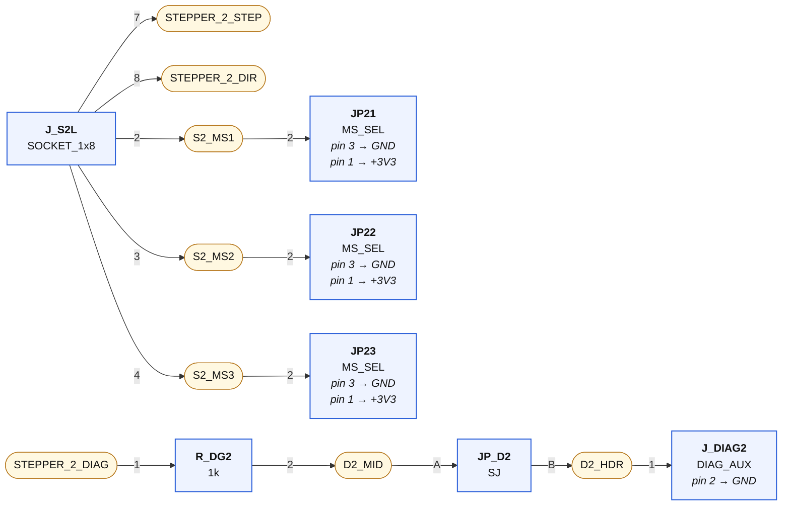
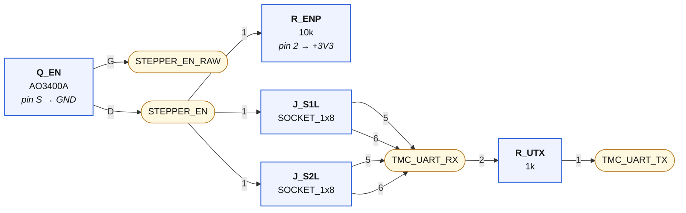
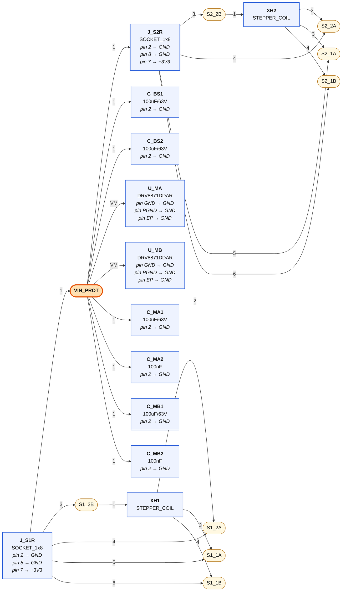
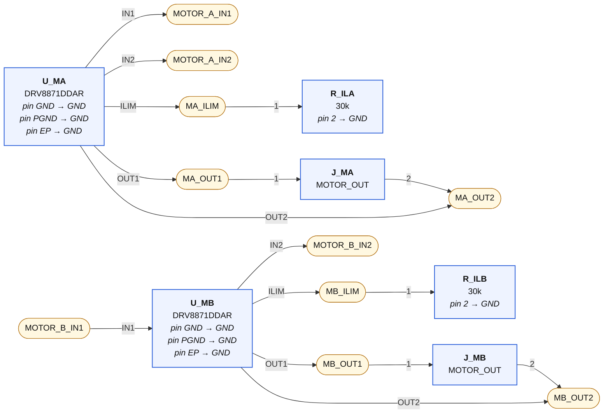

# 06-motors — wiring diagrams

Generated from `06-motors.net.yaml` by `tools/checknet.py --mermaid`. Read each diagram left to right along the signal path. **Boxes are parts, rounded nodes are nets, the label on a line is the pin.** A part's power-rail pins are written inside its box. A multi-unit chip (a quad gate) appears once per unit — one box per triangle, exactly as KiCad places it. Open the `.html` next to this file in any browser to see it rendered.

## Stepper socket 1 — logic row + straps

| Net | connect every one of these |
|---|---|
| **STEPPER_1_STEP** | `J_S1L.7` |
| **STEPPER_1_DIR** | `J_S1L.8` |
| **S1_MS1** | `J_S1L.2`, `JP11.2` |
| **S1_MS2** | `J_S1L.3`, `JP12.2` |
| **S1_MS3** | `J_S1L.4`, `JP13.2` |
| **STEPPER_1_DIAG** | `JP_D1.A` |
| **D1_HDR** | `JP_D1.B`, `J_DIAG1.1` |

## Stepper socket 2 — logic row + straps

| Net | connect every one of these |
|---|---|
| **STEPPER_2_STEP** | `J_S2L.7` |
| **STEPPER_2_DIR** | `J_S2L.8` |
| **S2_MS1** | `J_S2L.2`, `JP21.2` |
| **S2_MS2** | `J_S2L.3`, `JP22.2` |
| **S2_MS3** | `J_S2L.4`, `JP23.2` |
| **STEPPER_2_DIAG** | `R_DG2.1` |
| **D2_MID** | `R_DG2.2`, `JP_D2.A` |
| **D2_HDR** | `JP_D2.B`, `J_DIAG2.1` |

## Shared: EN inverter + UART bus

| Net | connect every one of these |
|---|---|
| **STEPPER_EN_RAW** | `Q_EN.G` |
| **STEPPER_EN** | `Q_EN.D`, `R_ENP.1`, `J_S1L.1`, `J_S2L.1` |
| **TMC_UART_RX** | `R_UTX.2`, `J_S1L.5`, `J_S1L.6`, `J_S2L.5`, `J_S2L.6` |
| **TMC_UART_TX** | `R_UTX.1` |

## Power rows + coils

| Net | connect every one of these |
|---|---|
| **VIN_PROT** | `J_S1R.1`, `J_S2R.1`, `C_BS1.1`, `C_BS2.1`, `U_MA.VM`, `U_MB.VM`, `C_MA1.1`, `C_MA2.1`, `C_MB1.1`, `C_MB2.1` |
| **S1_2B** | `J_S1R.3`, `XH1.1` |
| **S1_2A** | `J_S1R.4`, `XH1.2` |
| **S1_1A** | `J_S1R.5`, `XH1.3` |
| **S1_1B** | `J_S1R.6`, `XH1.4` |
| **S2_2B** | `J_S2R.3`, `XH2.1` |
| **S2_2A** | `J_S2R.4`, `XH2.2` |
| **S2_1A** | `J_S2R.5`, `XH2.3` |
| **S2_1B** | `J_S2R.6`, `XH2.4` |

## Brushed DC ×2 (DRV8871)

| Net | connect every one of these |
|---|---|
| **MOTOR_A_IN1** | `U_MA.IN1` |
| **MOTOR_A_IN2** | `U_MA.IN2` |
| **MA_ILIM** | `U_MA.ILIM`, `R_ILA.1` |
| **MA_OUT1** | `U_MA.OUT1`, `J_MA.1` |
| **MA_OUT2** | `U_MA.OUT2`, `J_MA.2` |
| **MOTOR_B_IN1** | `U_MB.IN1` |
| **MOTOR_B_IN2** | `U_MB.IN2` |
| **MB_ILIM** | `U_MB.ILIM`, `R_ILB.1` |
| **MB_OUT1** | `U_MB.OUT1`, `J_MB.1` |
| **MB_OUT2** | `U_MB.OUT2`, `J_MB.2` |

## GND

Every pin below goes to the GND symbol:

`Q_EN.S`, `J_S1R.2`, `J_S1R.8`, `J_S2R.2`, `J_S2R.8`, `JP11.3`, `JP12.3`, `JP13.3`, `JP21.3`, `JP22.3`, `JP23.3`, `J_DIAG1.2`, `J_DIAG2.2`, `C_BS1.2`, `C_BS2.2`, `U_MA.GND`, `U_MA.PGND`, `U_MA.EP`, `U_MB.GND`, `U_MB.PGND`, `U_MB.EP`, `R_ILA.2`, `R_ILB.2`, `C_MA1.2`, `C_MA2.2`, `C_MB1.2`, `C_MB2.2`

## +3V3

Every pin below goes to the +3V3 symbol:

`J_S1R.7`, `J_S2R.7`, `R_ENP.2`, `JP11.1`, `JP12.1`, `JP13.1`, `JP21.1`, `JP22.1`, `JP23.1`
