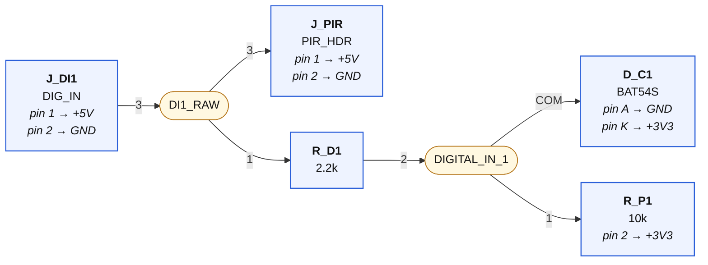
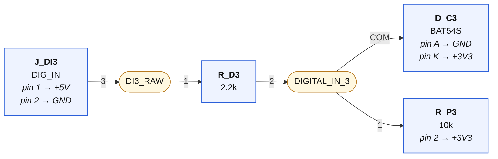
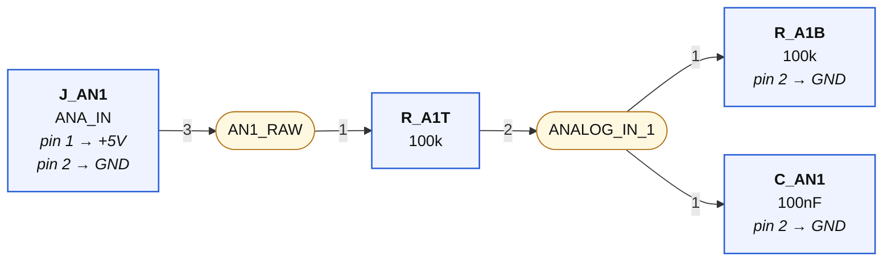
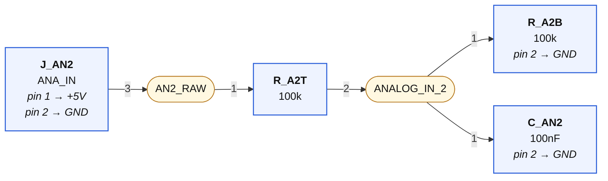
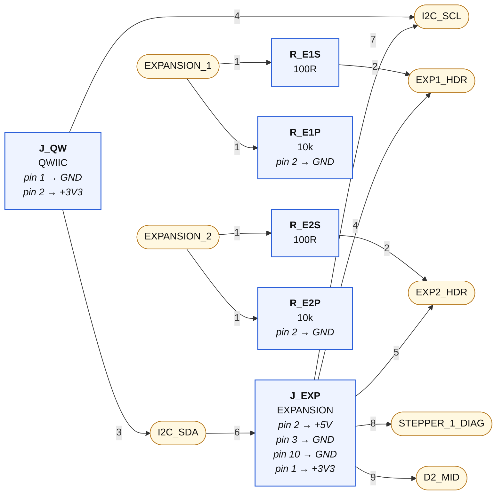

# 07-sensors-expansion — wiring diagrams

Generated from `07-sensors-expansion.net.yaml` by `tools/checknet.py --mermaid`. Read each diagram left to right along the signal path. **Boxes are parts, rounded nodes are nets, the label on a line is the pin.** A part's power-rail pins are written inside its box. A multi-unit chip (a quad gate) appears once per unit — one box per triangle, exactly as KiCad places it. Open the `.html` next to this file in any browser to see it rendered.

## Digital in 1 (+ PIR header)

| Net | connect every one of these |
|---|---|
| **DI1_RAW** | `J_DI1.3`, `J_PIR.3`, `R_D1.1` |
| **DIGITAL_IN_1** | `R_D1.2`, `D_C1.COM`, `R_P1.1` |

## Digital in 2

| Net | connect every one of these |
|---|---|
| **DI2_RAW** | `J_DI2.3`, `R_D2.1` |
| **DIGITAL_IN_2** | `R_D2.2`, `D_C2.COM`, `R_P2.1` |

## Digital in 3

| Net | connect every one of these |
|---|---|
| **DI3_RAW** | `J_DI3.3`, `R_D3.1` |
| **DIGITAL_IN_3** | `R_D3.2`, `D_C3.COM`, `R_P3.1` |

## Analog in 1

| Net | connect every one of these |
|---|---|
| **AN1_RAW** | `J_AN1.3`, `R_A1T.1` |
| **ANALOG_IN_1** | `R_A1T.2`, `R_A1B.1`, `C_AN1.1` |

## Analog in 2

| Net | connect every one of these |
|---|---|
| **AN2_RAW** | `J_AN2.3`, `R_A2T.1` |
| **ANALOG_IN_2** | `R_A2T.2`, `R_A2B.1`, `C_AN2.1` |

## Qwiic + expansion header

| Net | connect every one of these |
|---|---|
| **I2C_SDA** | `J_QW.3`, `J_EXP.6` |
| **I2C_SCL** | `J_QW.4`, `J_EXP.7` |
| **EXPANSION_1** | `R_E1S.1`, `R_E1P.1` |
| **EXP1_HDR** | `R_E1S.2`, `J_EXP.4` |
| **EXPANSION_2** | `R_E2S.1`, `R_E2P.1` |
| **EXP2_HDR** | `R_E2S.2`, `J_EXP.5` |
| **STEPPER_1_DIAG** | `J_EXP.8` |
| **D2_MID** | `J_EXP.9` |

## GND

Every pin below goes to the GND symbol:

`J_DI1.2`, `J_DI2.2`, `J_DI3.2`, `J_PIR.2`, `J_AN1.2`, `J_AN2.2`, `D_C1.A`, `D_C2.A`, `D_C3.A`, `R_A1B.2`, `R_A2B.2`, `C_AN1.2`, `C_AN2.2`, `J_QW.1`, `J_EXP.3`, `J_EXP.10`, `R_E1P.2`, `R_E2P.2`

## +5V

Every pin below goes to the +5V symbol:

`J_DI1.1`, `J_DI2.1`, `J_DI3.1`, `J_PIR.1`, `J_AN1.1`, `J_AN2.1`, `J_EXP.2`

## +3V3

Every pin below goes to the +3V3 symbol:

`D_C1.K`, `D_C2.K`, `D_C3.K`, `R_P1.2`, `R_P2.2`, `R_P3.2`, `J_QW.2`, `J_EXP.1`
