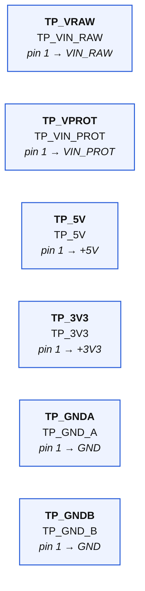

# 08-testpoints — wiring diagrams

Generated from `08-testpoints.net.yaml` by `tools/checknet.py --mermaid`. Read each diagram left to right along the signal path. **Boxes are parts, rounded nodes are nets, the label on a line is the pin.** A part's power-rail pins are written inside its box. A multi-unit chip (a quad gate) appears once per unit — one box per triangle, exactly as KiCad places it. Open the `.html` next to this file in any browser to see it rendered.

## GPIO test points

```mermaid
graph LR
  classDef part fill:#eef3ff,stroke:#2b5fd9,stroke-width:1.5px,color:#111
  classDef net fill:#fff8e1,stroke:#b7791f,color:#111
  classDef rail fill:#ffe0b2,stroke:#e65100,stroke-width:3px,color:#111,font-weight:bold
  classDef badnet fill:#ffe0e0,stroke:#c00,stroke-width:3px,color:#111,font-weight:bold
  classDef absent fill:#fff,stroke:#c00,stroke-width:2px,stroke-dasharray:6 4,color:#c00
  classDef extra fill:#ffecec,stroke:#c00,stroke-width:2px,color:#111
  classDef dnp fill:#f5f5f5,stroke:#999,stroke-dasharray:3 3,color:#666
  N_BOOT_BUTTON(["BOOT_BUTTON"]):::net
  P_TP_BOOT["<b>TP_BOOT</b><br/>BOOT_BUTTON"]:::part
  P_TP_BOOT --"1"--> N_BOOT_BUTTON
  N_ANALOG_IN_1(["ANALOG_IN_1"]):::net
  P_TP_AN1["<b>TP_AN1</b><br/>ANALOG_IN_1"]:::part
  N_ANALOG_IN_1 --"1"--> P_TP_AN1
  N_ANALOG_IN_2(["ANALOG_IN_2"]):::net
  P_TP_AN2["<b>TP_AN2</b><br/>ANALOG_IN_2"]:::part
  N_ANALOG_IN_2 --"1"--> P_TP_AN2
  N_LED_STRIP_1_CLK(["LED_STRIP_1_CLK"]):::net
  P_TP_L1C["<b>TP_L1C</b><br/>LED_STRIP_1_CLK"]:::part
  N_LED_STRIP_1_CLK --"1"--> P_TP_L1C
  P_R_STRAP3["<b>R_STRAP3</b><br/>DNP<br/><i>pin 2 → GND</i>"]:::dnp
  N_LED_STRIP_1_CLK --"1"--> P_R_STRAP3
  N_LED_STRIP_1_DATA(["LED_STRIP_1_DATA"]):::net
  P_TP_L1D["<b>TP_L1D</b><br/>LED_STRIP_1_DATA"]:::part
  N_LED_STRIP_1_DATA --"1"--> P_TP_L1D
  N_LED_STRIP_2_DATA(["LED_STRIP_2_DATA"]):::net
  P_TP_L2D["<b>TP_L2D</b><br/>LED_STRIP_2_DATA"]:::part
  N_LED_STRIP_2_DATA --"1"--> P_TP_L2D
  N_LED_STRIP_2_CLK(["LED_STRIP_2_CLK"]):::net
  P_TP_L2C["<b>TP_L2C</b><br/>LED_STRIP_2_CLK"]:::part
  N_LED_STRIP_2_CLK --"1"--> P_TP_L2C
  N_I2S_BCLK(["I2S_BCLK"]):::net
  P_TP_BCLK["<b>TP_BCLK</b><br/>I2S_BCLK"]:::part
  N_I2S_BCLK --"1"--> P_TP_BCLK
  N_I2C_SDA(["I2C_SDA"]):::net
  P_TP_SDA["<b>TP_SDA</b><br/>I2C_SDA"]:::part
  N_I2C_SDA --"1"--> P_TP_SDA
  N_I2C_SCL(["I2C_SCL"]):::net
  P_TP_SCL["<b>TP_SCL</b><br/>I2C_SCL"]:::part
  N_I2C_SCL --"1"--> P_TP_SCL
  N_DIGITAL_IN_1(["DIGITAL_IN_1"]):::net
  P_TP_DI1["<b>TP_DI1</b><br/>DIGITAL_IN_1"]:::part
  N_DIGITAL_IN_1 --"1"--> P_TP_DI1
  N_DIGITAL_IN_2(["DIGITAL_IN_2"]):::net
  P_TP_DI2["<b>TP_DI2</b><br/>DIGITAL_IN_2"]:::part
  N_DIGITAL_IN_2 --"1"--> P_TP_DI2
  N_DIGITAL_IN_3(["DIGITAL_IN_3"]):::net
  P_TP_DI3["<b>TP_DI3</b><br/>DIGITAL_IN_3"]:::part
  N_DIGITAL_IN_3 --"1"--> P_TP_DI3
  N_STEPPER_1_STEP(["STEPPER_1_STEP"]):::net
  P_TP_S1S["<b>TP_S1S</b><br/>STEPPER_1_STEP"]:::part
  N_STEPPER_1_STEP --"1"--> P_TP_S1S
  N_STEPPER_1_DIR(["STEPPER_1_DIR"]):::net
  P_TP_S1D["<b>TP_S1D</b><br/>STEPPER_1_DIR"]:::part
  N_STEPPER_1_DIR --"1"--> P_TP_S1D
  N_I2S_LRCLK(["I2S_LRCLK"]):::net
  P_TP_LRCLK["<b>TP_LRCLK</b><br/>I2S_LRCLK"]:::part
  N_I2S_LRCLK --"1"--> P_TP_LRCLK
  N_I2S_DOUT(["I2S_DOUT"]):::net
  P_TP_DOUT["<b>TP_DOUT</b><br/>I2S_DOUT"]:::part
  N_I2S_DOUT --"1"--> P_TP_DOUT
  N_TMC_UART_TX(["TMC_UART_TX"]):::net
  P_TP_UTX["<b>TP_UTX</b><br/>TMC_UART_TX"]:::part
  N_TMC_UART_TX --"1"--> P_TP_UTX
  N_TMC_UART_RX(["TMC_UART_RX"]):::net
  P_TP_URX["<b>TP_URX</b><br/>TMC_UART_RX"]:::part
  N_TMC_UART_RX --"1"--> P_TP_URX
  N_STEPPER_2_STEP(["STEPPER_2_STEP"]):::net
  P_TP_S2S["<b>TP_S2S</b><br/>STEPPER_2_STEP"]:::part
  N_STEPPER_2_STEP --"1"--> P_TP_S2S
  N_MOTOR_B_IN1(["MOTOR_B_IN1"]):::net
  P_TP_MB1["<b>TP_MB1</b><br/>MOTOR_B_IN1"]:::part
  N_MOTOR_B_IN1 --"1"--> P_TP_MB1
  N_MOTOR_B_IN2(["MOTOR_B_IN2"]):::net
  P_TP_MB2["<b>TP_MB2</b><br/>MOTOR_B_IN2"]:::part
  N_MOTOR_B_IN2 --"1"--> P_TP_MB2
  N_STATUS_LED(["STATUS_LED"]):::net
  P_TP_STAT["<b>TP_STAT</b><br/>STATUS_LED"]:::part
  N_STATUS_LED --"1"--> P_TP_STAT
  N_SD_CLK(["SD_CLK"]):::net
  P_TP_SDCLK["<b>TP_SDCLK</b><br/>SD_CLK"]:::part
  N_SD_CLK --"1"--> P_TP_SDCLK
  N_SD_CMD(["SD_CMD"]):::net
  P_TP_SDCMD["<b>TP_SDCMD</b><br/>SD_CMD"]:::part
  N_SD_CMD --"1"--> P_TP_SDCMD
  N_SD_D0(["SD_D0"]):::net
  P_TP_SDD0["<b>TP_SDD0</b><br/>SD_D0"]:::part
  N_SD_D0 --"1"--> P_TP_SDD0
  N_STEPPER_1_DIAG(["STEPPER_1_DIAG"]):::net
  P_TP_DG1["<b>TP_DG1</b><br/>STEPPER_1_DIAG"]:::part
  N_STEPPER_1_DIAG --"1"--> P_TP_DG1
  N_STEPPER_2_DIAG(["STEPPER_2_DIAG"]):::net
  P_TP_DG2["<b>TP_DG2</b><br/>STEPPER_2_DIAG"]:::part
  N_STEPPER_2_DIAG --"1"--> P_TP_DG2
  N_MOTOR_A_IN1(["MOTOR_A_IN1"]):::net
  P_TP_MA1["<b>TP_MA1</b><br/>MOTOR_A_IN1"]:::part
  N_MOTOR_A_IN1 --"1"--> P_TP_MA1
  N_EXPANSION_1(["EXPANSION_1"]):::net
  P_TP_EXP1["<b>TP_EXP1</b><br/>EXPANSION_1"]:::part
  N_EXPANSION_1 --"1"--> P_TP_EXP1
  N_EXPANSION_2(["EXPANSION_2"]):::net
  P_TP_EXP2["<b>TP_EXP2</b><br/>EXPANSION_2"]:::part
  N_EXPANSION_2 --"1"--> P_TP_EXP2
  N_STEPPER_2_DIR(["STEPPER_2_DIR"]):::net
  P_TP_S2D["<b>TP_S2D</b><br/>STEPPER_2_DIR"]:::part
  N_STEPPER_2_DIR --"1"--> P_TP_S2D
  N_MOTOR_A_IN2(["MOTOR_A_IN2"]):::net
  P_TP_MA2["<b>TP_MA2</b><br/>MOTOR_A_IN2"]:::part
  N_MOTOR_A_IN2 --"1"--> P_TP_MA2
```

| Net | connect every one of these |
|---|---|
| **BOOT_BUTTON** | `TP_BOOT.1` |
| **ANALOG_IN_1** | `TP_AN1.1` |
| **ANALOG_IN_2** | `TP_AN2.1` |
| **LED_STRIP_1_CLK** | `TP_L1C.1`, `R_STRAP3.1` |
| **LED_STRIP_1_DATA** | `TP_L1D.1` |
| **LED_STRIP_2_DATA** | `TP_L2D.1` |
| **LED_STRIP_2_CLK** | `TP_L2C.1` |
| **I2S_BCLK** | `TP_BCLK.1` |
| **I2C_SDA** | `TP_SDA.1` |
| **I2C_SCL** | `TP_SCL.1` |
| **DIGITAL_IN_1** | `TP_DI1.1` |
| **DIGITAL_IN_2** | `TP_DI2.1` |
| **DIGITAL_IN_3** | `TP_DI3.1` |
| **STEPPER_1_STEP** | `TP_S1S.1` |
| **STEPPER_1_DIR** | `TP_S1D.1` |
| **I2S_LRCLK** | `TP_LRCLK.1` |
| **I2S_DOUT** | `TP_DOUT.1` |
| **TMC_UART_TX** | `TP_UTX.1` |
| **TMC_UART_RX** | `TP_URX.1` |
| **STEPPER_2_STEP** | `TP_S2S.1` |
| **MOTOR_B_IN1** | `TP_MB1.1` |
| **MOTOR_B_IN2** | `TP_MB2.1` |
| **STATUS_LED** | `TP_STAT.1` |
| **SD_CLK** | `TP_SDCLK.1` |
| **SD_CMD** | `TP_SDCMD.1` |
| **SD_D0** | `TP_SDD0.1` |
| **STEPPER_1_DIAG** | `TP_DG1.1` |
| **STEPPER_2_DIAG** | `TP_DG2.1` |
| **MOTOR_A_IN1** | `TP_MA1.1` |
| **EXPANSION_1** | `TP_EXP1.1` |
| **EXPANSION_2** | `TP_EXP2.1` |
| **STEPPER_2_DIR** | `TP_S2D.1` |
| **MOTOR_A_IN2** | `TP_MA2.1` |

## Rail-only parts ×6 — decoupling; wire each pin to its rail symbol, place beside its chip

| Net | connect every one of these |
|---|---|

## GND

Every pin below goes to the GND symbol:

`TP_GNDA.1`, `TP_GNDB.1`, `R_STRAP3.2`

## +5V

Every pin below goes to the +5V symbol:

`TP_5V.1`

## +3V3

Every pin below goes to the +3V3 symbol:

`TP_3V3.1`

## VIN_RAW

Every pin below goes to the VIN_RAW symbol:

`TP_VRAW.1`

## VIN_PROT

Every pin below goes to the VIN_PROT symbol:

`TP_VPROT.1`
