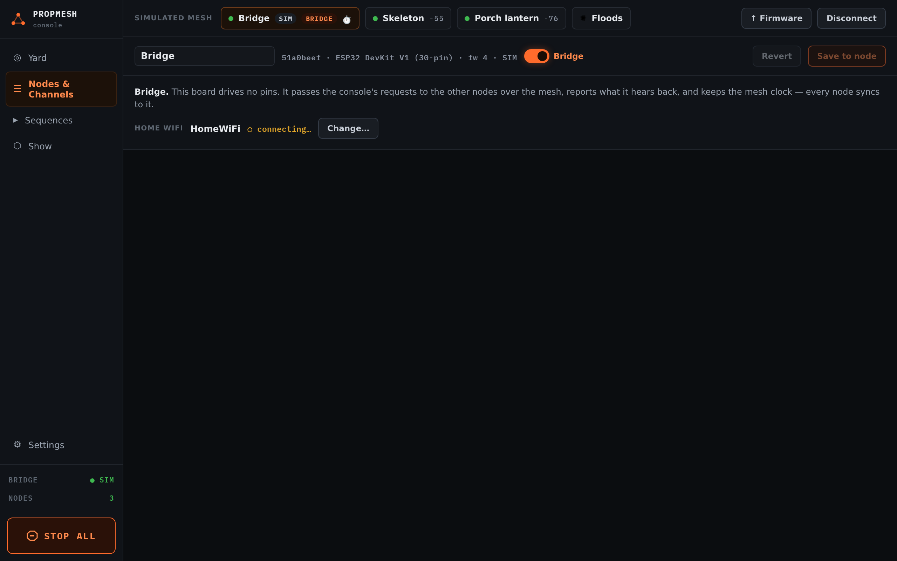

import { Aside } from '@astrojs/starlight/components';

## Connecting

**"USB needs Web Serial."** The console reaches boards over USB through a browser feature that only **Chrome** and **Edge** on a desktop or laptop have. Safari, Firefox and phones can still use the console over WiFi, or the simulator.

**The board isn't in the USB list.** Try another cable, since many only carry power. Install the CP210x or CH340 driver (see [Install the firmware](/propmesh/start/flash/#if-it-doesnt-work)). Close anything else that is using the board, because only one program can hold its port at a time.

**Connecting over WiFi fails.** The bridge has to be set up for your WiFi first, over USB. Open it in the console, and under **HOME WIFI** press **Set up home WiFi…**. Enter your network, which must be 2.4 GHz because ESP32 boards can't use 5 GHz, and press **Save to node**. Its row then shows the address to use. On most home networks `propmesh.local` works too.

## Boards

**"No other nodes heard yet."** Is the second board flashed and powered? Boards report in every few seconds, so give it ten. Try moving it closer.

**A board turns red.** The console hasn't heard from it for about 16 seconds. It is unplugged, out of range, or (on battery) asleep. A sleeping board shows **☾ asleep** instead of red.

**A board restarts when a servo or strip moves.** Its power is dipping. Give servos and strips their own supply and join the grounds. See [Servos](/propmesh/props/servos/) and [LED strips](/propmesh/props/led-strips/).

**A relay clicks or a motor jumps when the board powers on.** It is on a pin that pulses at start-up. Move it to a pin marked ★ for relays on the [board's page](/propmesh/boards/).

**The board won't start after wiring something.** Some pins have to be at a particular level when the board starts. They are marked "STRAPPING" on the board pages. A module that pulls one of them the wrong way stops the board from booting. Unplug the module, check the pin's note, and move it.

## The show

**▶ Play says the show is off.** Switch the show to **Ambient** or **Armed** in **Show** first.

**A sensor shows ● ACTIVE but nothing happens.** The show must be **Armed**, the trigger must be saved with **Save triggers**, and the chain must be complete (no **UNWIRED** blocks). Also check for a **Cooldown** or **Lockout** that is holding it back.

**The show didn't come on at dusk.** Open **Schedule…** and check the **TODAY** column, which says when each window runs today. Check that the boards have power. Boards learn the time of day from the console when it connects, or from the internet when the bridge is on WiFi, and they share it over the mesh. After a power cut with no bridge on WiFi, a board with a schedule waits a minute for the time, then runs **Armed** until it learns the time. Connect the console once and the schedule takes over again.

**The flood lights don't respond.** Lights only hear the boards ticked under **SENDING BOARDS**, and only when one is within range. They never reply, so the console can't tell whether a light heard. Move a sending board closer.

<Aside title="Still stuck?">
Ask on [GitHub](https://github.com/mrwillson2u/propmesh/issues). Say which boards you have, what you expected and what happened. A screenshot of the console helps a lot.
</Aside>
