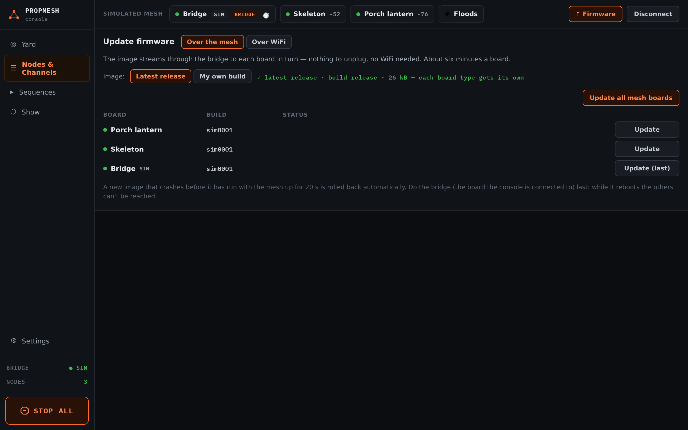

import { Aside, Steps } from '@astrojs/starlight/components';

Once a board runs PropMesh, updates reach it over the mesh from the console. You shouldn't need to plug it in again.

<Steps>

1. In **Nodes & Channels**, open the **↑ Firmware** panel and choose **Over the mesh**.

2. Leave **Image** on **Latest release**. The console fetches the current firmware from this site on its own and shows **✓ latest release** with the build name. Each board type gets its own image, so a mixed yard of DevKits and Feathers is fine.

3. Press **Update all mesh boards**, or **Update** on one board. Each board takes a few minutes, and the table shows how far along it is.

4. Update the bridge, which is the board your console is connected to, **last**, with **Update (last)**.

</Steps>

<Aside title="Safe to interrupt">
If an update stops partway because a board loses power or you close the laptop, the board shows **paused**, and **Update** resumes it. A board that can't start the new firmware rolls back to the old one on its own.
</Aside>

<Aside type="note" title="Until the next release">
**Latest release** needs two files this site only started publishing on 2026-10-14. If the panel says it couldn't load the release, pick **My own build** instead, press **from file**, and choose the update file for your board type from [Install the firmware](/propmesh/start/flash/).
</Aside>

**My own build** is for people building the firmware themselves: paste the URL from `tools/ota_serve.py`, or pick a `.bin` file.

**Over WiFi** is the faster option when your boards are in range of your home WiFi. Each board joins the network and downloads the update itself. It needs the image served from a computer on your network, which is covered in the project's developer notes.
