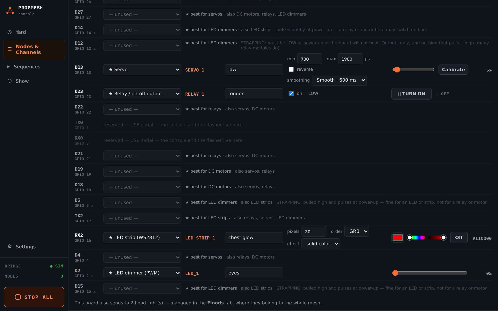

import { Aside } from '@astrojs/starlight/components';

Addressable LED strips are the quickest way to make a prop look alive: glowing eyes, a lantern that flickers, a cauldron that bubbles green.

<Aside type="caution" title="Not yet tested on a real strip">
The strip driver was rewritten in October 2026, and the clocked-strip support and the fire effect are new. None of the three has been run on a real strip yet, only on the bench without one. If your strip stays dark or shows the wrong colors, please [report it](https://github.com/mrwillson2u/propmesh/issues) with the strip type and board.
</Aside>

## Which strip?

| Strip | Wires to the board | Console function |
|---|---|---|
| **WS2812B** (often sold as "NeoPixel") | one data wire | **LED strip (WS2812)** |
| **SK9822** or **APA102** ("DotStar") | data **and** clock | **LED strip (SK9822 / APA102, clocked)** |

Either kind works. WS2812 is cheaper and easier to find. The clocked kind is more forgiving about timing and long wires. Each board page says how many strips it can run. The DevKit V1 can run up to 8 WS2812 strips.

## Wiring

```
Power supply 5V ─────────────── strip 5V
Power supply GND ──┬─────────── strip GND
                   └─────────── board GND
Board pin ── level shifter ──── strip DIN  (and CLK for a clocked strip)
```

1. **Power the strip from its own 5 V supply**, not from the board. A pixel at full white draws about 60 mA, so 30 pixels can want nearly 2 A. That is far more than a USB port or the board's regulator can give.
2. **Join the grounds.** The supply's GND, the strip's GND and the board's GND all connect together. A strip that flickers at random very often has a missing ground.
3. **Use a level shifter on the data line.** The board's signal is 3.3 V and a 5 V strip expects close to 5 V. It often works without one, until the night is cold or the wire is long, and then it flickers. A **74AHCT125** (or the one-channel **74AHCT1G125**) fixes it for under a dollar.

<Aside type="tip" title="Two small extras that prevent headaches">
A **330 Ω resistor** in series with the data line, close to the strip, and a **1000 µF capacitor** across 5 V and GND where the power enters the strip.
</Aside>

## Setting it up in the console

Assign the pin to **LED strip (WS2812)** and set:

- **pixels**: how many LEDs are on the strip (up to 300).
- **order**: the color order. Try **GRB** first, which most WS2812 strips use. If red shows up as green, switch to **RGB**.
- **effect**: **solid color** or **fire**.



**Save to node**, then use the color picker in the TEST column. In a sequence, a solid strip takes any color, and **Off** turns it dark.

## The fire effect

Set **effect** to **fire** for a flame that never repeats. It suits lanterns, jack-o'-lanterns and torches. The **FIRE** settings shape it:

| Setting | What it changes |
|---|---|
| **columns**, **height**, **zigzag**, **starts at top** | how your strip is arranged. A single strip is 1 column. A strip folded or cut into side-by-side columns has several, and *zigzag* means each column runs back the other way from the one before. Tick *starts at top* when the strip's data wire comes in at the top. If the flames burn downward, this is the box to change. |
| **brightness**, **speed** | how bright and how lively |
| **flame**, **noise** | how tall and how ragged the flames are |
| **smoke**, **smoke speed**, **smoke scale** | the darker, drifting layer on top |

In the TEST column a fire strip has **Burn** and **Out**. In a sequence, any value other than zero means burning.

<Aside>The fire effect is a port of the "Fire2023" example from the FastLED project.</Aside>
