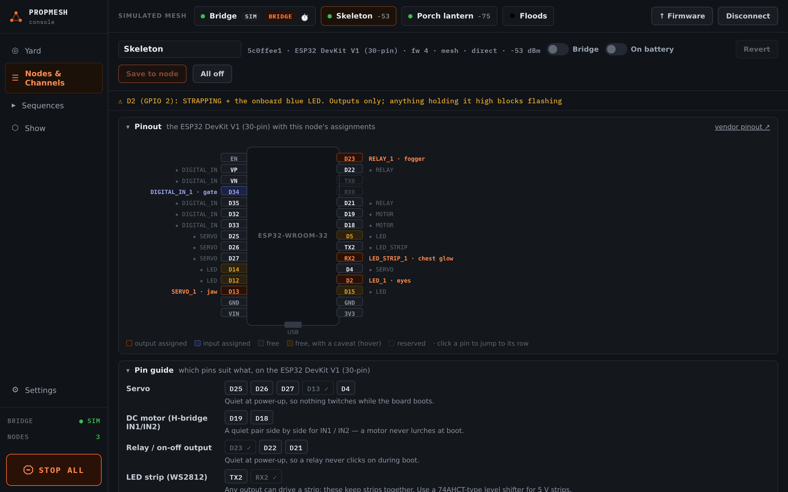

import { Aside } from '@astrojs/starlight/components';

A sensor is how the yard knows someone is there. Anything that switches a wire on or off will work.

| Sensor | Good for | Notes |
|---|---|---|
| **PIR motion** (HC-SR501, AM312) | "someone walked up" | needs about a minute to settle after power-up. The knobs on an HC-SR501 set its range and how long it stays on. |
| **Pressure mat** | "someone stepped *here*" | a switch: wire it like a button |
| **Break-beam** (IR or laser) | "someone crossed the path" | precise and fast, good for a hallway |
| **Button** | a manual "go" | wire it between a pin and GND |

## Wiring

**Sensors with their own output** (PIR, beam receivers): wire power, ground, and their **OUT** to a board pin. In the console set **pull** to **none**, because the sensor drives the pin itself.

**Switches** (buttons, pressure mats, reed switches): one wire to the pin, the other to **GND**. Set **pull** to **up** and tick **active = LOW**. The pin then reads "on" when the switch connects it to ground.

<Aside type="tip" title="Which pin?">
Some pins can only be inputs. On the DevKit V1 those are VP, VN, D34 and D35. Use them for sensors and keep the other pins free for outputs. Those four have no internal pull-up, though, so a **button** on one of them needs an extra resistor. Put buttons on a pin that has a pull-up instead. The board pages list which pins are which.
</Aside>

## In the console

Assign the pin to **Sensor / button input**, set **pull** and **active = LOW** as above, and **Save to node**. The TEST column shows **● ACTIVE** or **○ clear** live. Walk past, step on the mat or press the button and watch it change.

Then make it do something: see [Triggers](/propmesh/show/triggers/).

<Aside title="On a battery board">
A battery prop sleeps when the show is off, and only some pins can wake it. Put its sensor on one of those. The console warns you if you don't. See [Battery props](/propmesh/props/battery/).
</Aside>
