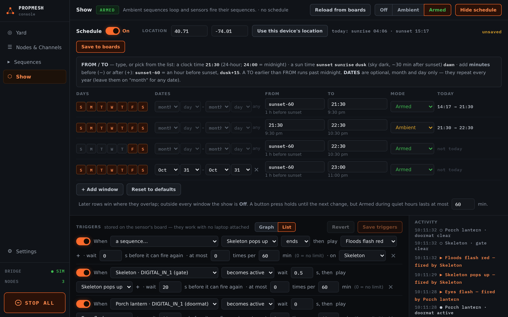
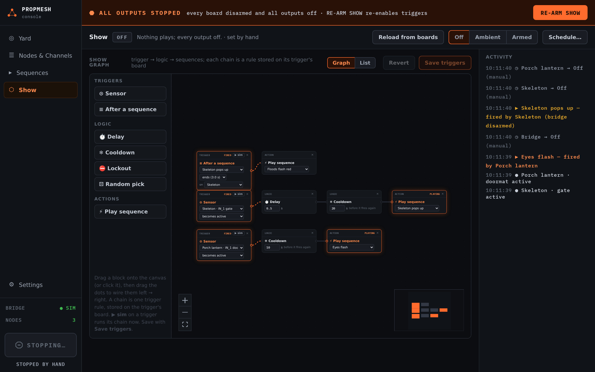

import { Aside } from '@astrojs/starlight/components';

## Three modes

At the top of **Show**:

| Mode | What happens |
|---|---|
| **Off** | nothing plays, and every output is off |
| **Ambient** | [ambient loops](/propmesh/show/sequences/#ambient-loops) run (lights, fog), but sensors don't set off scares |
| **Armed** | ambient loops run **and** sensors fire their sequences |

Pressing a mode holds it until the schedule's next change. Without a schedule, the boards start out armed and a mode you press holds until you press another one.

## The schedule

Press **Schedule…** to set when the show runs on its own.

1. Under **LOCATION**, press **Use this device's location**, or type a latitude and longitude (west is negative). This is how the console works out your sunrise and sunset.
2. Add windows with **+ Add window**. Each window has **DAYS**, **DATES**, **FROM**, **TO** and the **MODE** to be in. You can have up to 12.
3. Press **Save to boards.**

**FROM** and **TO** take a clock time such as `21:30`, or the sun: `sunset`, `sunrise`, `dusk` or `dawn`, with an offset in minutes. `sunset-60` is an hour before sunset and `dusk+15` is fifteen minutes after dusk. **DATES** limit a window to part of the year (month and day), so October can be scarier than December.

A typical Halloween schedule:

| DAYS | DATES | FROM | TO | MODE |
|---|---|---|---|---|
| every day | Oct 1 – Oct 31 | `sunset-30` | `22:00` | Ambient |
| Fri, Sat | Oct 1 – Oct 31 | `dusk` | `22:00` | Armed |
| every day | Oct 31 | `sunset-60` | `23:00` | Armed |

Where windows overlap, the lower row wins. Outside every window the show is **Off**. The **TODAY** column shows exactly when each window runs today.

<Aside title="Pressing a button against the schedule">
If you press a mode that is *more* active than what the schedule says, such as **Armed** during an Ambient window or anything at all after hours, it lasts for at most an hour, then the schedule takes over again. That way a late-night test doesn't leave the yard screaming until morning. The limit is a setting in the schedule panel.
</Aside>

## STOP ALL

The big button at the bottom left. **Press and hold it** for about a second and a half. Every board disarms and every output turns off: strips, servos, relays and flood lights. A banner says **ALL OUTPUTS STOPPED** and names any board that didn't confirm.

**RE-ARM SHOW** in that banner turns the triggers back on.

<Aside type="caution">STOP ALL needs the console to be connected to the bridge. For a prop that could hurt someone, such as a fast pneumatic or anything near a walkway, build in a physical stop as well.</Aside>
